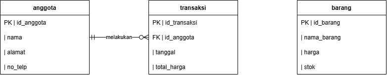
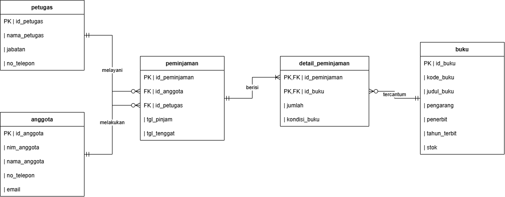

# Laporan Praktikum Basis Data - Pertemuan 03
**Nama:** Gustyan Tama Tiyadie   **NIM:** 25430113   **Kelas:** D   **Tanggal:** 14 Oktober 2026

---

## 1. Tujuan Praktikum
1. Mampu mengidentifikasi entitas, atribut, dan kunci dari dokumen kebutuhan data.
2. Mampu menentukan relasi beserta kardinalitas dan partisipasinya berdasarkan aturan bisnis.
3. Mampu memecah relasi banyak-ke-banyak menjadi entitas asosiatif.
4. Mampu menggambar ERD notasi Crow's Foot dan memvalidasinya terhadap kebutuhan informasi (KI).

## 2. Ringkasan Dasar Teori
* **Entitas, Atribut, & Relasi:** Model ER menggambarkan data sebagai entitas (benda/kejadian yang dicatat), atribut (sifat/kolom), dan relasi (hubungan antarentitas).
* **Kardinalitas & Partisipasi:** Menggunakan notasi *Crow's Foot* untuk menunjukkan jumlah maksimum (simbol di dekat entitas) dan minimum (simbol di luar) dari suatu relasi.
* **Entitas Asosiatif:** Solusi untuk memecah relasi banyak-ke-banyak ($M:N$) yang memiliki atribut tambahan tersendiri (seperti `detail_penjualan` yang memuat `qty` dan `harga` saat transaksi).

## 3. Hasil Langkah Percobaan
Berikut adalah pelaksanaan langkah percobaan ERD berbasis studi kasus Koperasi Mahasiswa (Kopma Sejahtera):

### **D.1 Dari Entitas Kandidat ke Entitas**
* Atribut kunci primer (`PK`), kunci alternatif, dan atribut turunan pada entitas Kopma telah dipetakan dari dokumen kebutuhan data Modul 2.
* Entitas kandidat "Pembelian dan detailnya" dipecah menjadi `pembelian` dan `detail_pembelian`.

### **D.2 Menentukan Relasi dan Kardinalitas**

| Relasi | Sisi Kiri | Sisi Kanan | Dasar (Aturan Bisnis) |
| :--- | :--- | :--- | :--- |
| petugas melayani peminjaman | tepat satu petugas | nol atau banyak peminjaman | AB-01 |
| anggota melakukan peminjaman | tepat satu anggota | nol atau banyak peminjaman | AB-02 |
| peminjaman berisi detail_peminjaman | tepat satu peminjaman | satu atau banyak detail | AB-04 |
| buku tercantum di detail_peminjaman | tepat satu buku | nol atau banyak detail | AB-03 |

### **D.3 Menggambar ERD**
* ERD konseptual Kopma telah digambar menggunakan *draw.io* dengan mencakup seluruh entitas, atribut, kunci (`PK`/`FK`), serta notasi kardinalitas *Crow's Foot*. Berkas disimpan sebagai `p03_erd_kopma_25430113.drawio` dan diekspor ke format gambar. 

### **D.4 Memvalidasi ERD terhadap Kebutuhan Informasi (KI)**
### **1. Penelusuran Jalur ERD Berdasarkan Kebutuhan Informasi (KI)**
* **KI-01 (Riwayat Peminjaman Anggota):** anggota -> peminjaman -> detail_peminjaman -> buku
* **KI-02 (Petugas yang Melayani Peminjaman):** petugas -> peminjaman
* **KI-03 (Ketersediaan Stok Buku):** buku -> detail_peminjaman -> peminjaman

### **2. Catatan Umpan Balik Klien (Simulasi Diskusi dengan Rekan Sebelah)**
* **Umpan Balik 1:** Penambahan informasi kontak (email) pada entitas anggota untuk memudahkan pemberitahuan denda via email.
  * **Keputusan:** **Diterima**, karena memperkaya atribut identitas anggota.
* **Umpan Balik 2:** Penambahan atribut kondisi buku saat dikembalikan pada entitas relasi.
  * **Keputusan:** **Diterima**, agar perpustakaan dapat melacak riwayat kerusakan buku.  

## 4. Jawaban Titik Analisis

### **Titik Analisis 1**
**Pertanyaan:** `no_anggota` dan `nim_anggota` sama-sama unik. Mengapa buku ini tetap memakai `id_anggota` sebagai kunci primer? Sebutkan satu risiko jika NIM dijadikan kunci primer.
**Jawaban:** 
* Penggunaan `id_anggota` sebagai kunci primer (*surrogate key* berbasis integer otomatis) dipilih agar relasi antar-tabel menjadi lebih stabil, seragam, dan efisien saat digabungkan menggunakan `JOIN`. 
* **Risiko jika NIM dijadikan kunci primer:** Jika suatu saat terjadi kesalahan input data NIM oleh pengguna, atau pihak universitas mengeluarkan kebijakan perubahan format digit NIM, maka seluruh tabel anak yang mereferensikan NIM tersebut sebagai *foreign key* akan ikut terganggu dan harus di-*update* secara masif, yang berisiko merusak integritas data historis transaksi.

### **Titik Analisis 2: Sisi penjualan terhadap detail_penjualan bernilai 1..N (satu atau banyak)**
* **Jawaban:** Aturan bisnis **AB-01** mewajibkan setiap nota penjualan memiliki minimal satu baris barang. Sisi "minimal satu" ini dipastikan melalui logika transaksi bisnis, meskipun pada tingkat struktur murni database relasional nantinya akan dikontrol melalui mekanisme integritas transaksional (Modul 14).

### **Titik Analisis 3: Menjawab pertanyaan "petugas gudang mana yang menerima barang dari pemasok"**
* **Jawaban:** Pada ERD awal, tabel `pembelian` belum terhubung langsung ke entitas `petugas` (gudang). Untuk menjawab pertanyaan tersebut, perlu ditambahkan kolom kunci tamu `id_petugas` di dalam tabel `pembelian` yang merujuk ke tabel `petugas`. Hal ini dicatat sebagai penyempurnaan aturan operasional gudang.

## 5. Hasil Latihan dan Modifikasi
1. **Poin Loyalitas:** Atribut poin loyalitas ditambahkan ke entitas `anggota` untuk mendukung skema perhitungan poin belanja otomatis.
2. **Uji Coba Relasi Langsung:** Simulasi relasi banyak-ke-banyak langsung antara penjualan dan barang tanpa entitas asosiatif terbukti menghilangkan informasi kuantiti (`qty`) dan harga historis per item barang.

## 6. Tugas Mandiri: Milestone Proyek 3
* **Berkas Proyek ERD:** Berkas diagram sumber `p03_erd_25430113.drawio` dan gambar `p03_erd_25430113.png` telah disusun lengkap untuk proyek **Perpustakaan Cakrawala GT** (`perpus_113`).

* **Entitas Asosiatif:** Menggunakan entitas asosiatif `detail_peminjaman` yang dilengkapi atribut `qty` dan status kondisi buku.
* **Penelusuran KI:** Seluruh Kebutuhan Informasi proyek (KI-01 s.d. KI-05) berhasil divalidasi melintasi jalur ERD proyek.

## 7. Pembahasan dan Kendala
* **Pembahasan:** Penentuan kardinalitas menuntut pemahaman mendalam terhadap aturan bisnis agar tidak terjadi kesalahan pemodelan relasi (seperti tertukarnya posisi *Crow's Foot*).
* **Kendala:** Penyesuaian garis relasi agar tidak saling tumpang tindih (*overlapping*) di *draw.io* memerlukan ketelitian tata letak (*layouting*).
* **Solusi:** Mengelompokkan tabel master di bagian atas dan tabel transaksi di bagian tengah/bawah secara simetris.

## 8. Kesimpulan
1. ERD konseptual untuk sistem perpustakaan telah berhasil dirancang sesuai standar notasi *Crow's Foot*.
2. Seluruh relasi dan kardinalitas telah divalidasi terhadap aturan bisnis dan berhasil menjawab seluruh Kebutuhan Informasi (KI).
3. Berkas diagram sumber `.drawio` dan gambar `.png` telah disimpan di dalam repositori lokal.

## 9. Pernyataan Penggunaan AI
Saya menggunakan Gemini sebagai teman diskusi untuk mengecek kardinalitas, notasi ERD Crow’s Foot, dan tata bahasa laporan. Semua rancangan entitas, kunci, dan validasi kasus proyek saya kerjakan sendiri.

## 10. Bukti Git
* **Tautan Repositori:**https://github.com/gustyantamatiyadie837-tech/basisdata-25430113.git
* **Hash Commit Terakhir:**e0fcc6a

---

## Checklist
- [x] Berkas wajib: `p03_erd_25430113.drawio` dan `p03_erd_25430113.png` (serta versi Kopma)
- [x] ERD digambar di draw.io dengan kardinalitas terbaca jelas
- [x] Pemetaan entitas ke proses bisnis dan KI dari Pertemuan 2
- [x] Penjelasan alasan kardinalitas relasi utama
- [x] Daftar dependensi & entitas asosiatif tercantum
- [x] Catatan tinjauan klien (minimal 2 umpan balik) terpenuhi
- [x] Laporan praktikum Modul 3 lengkap sesuai struktur baku