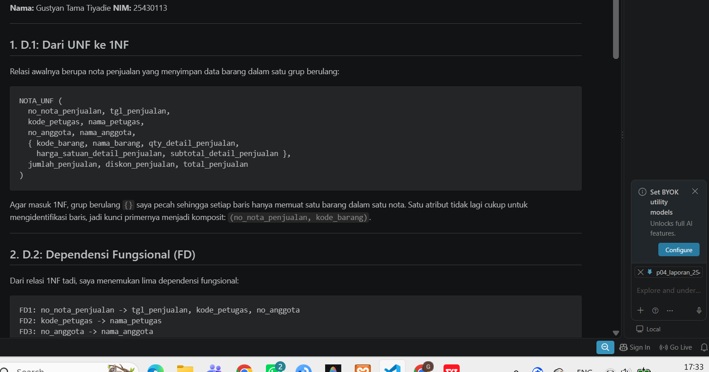
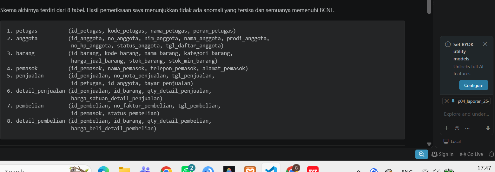
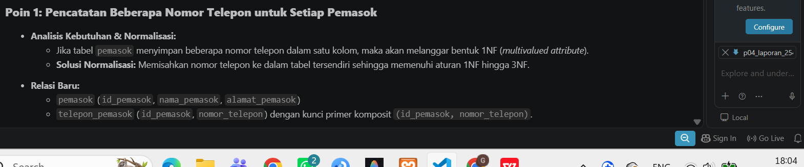
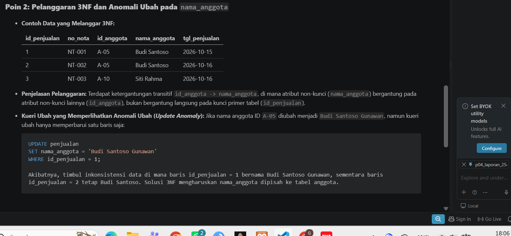
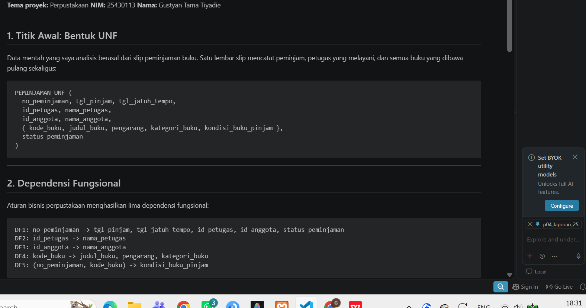
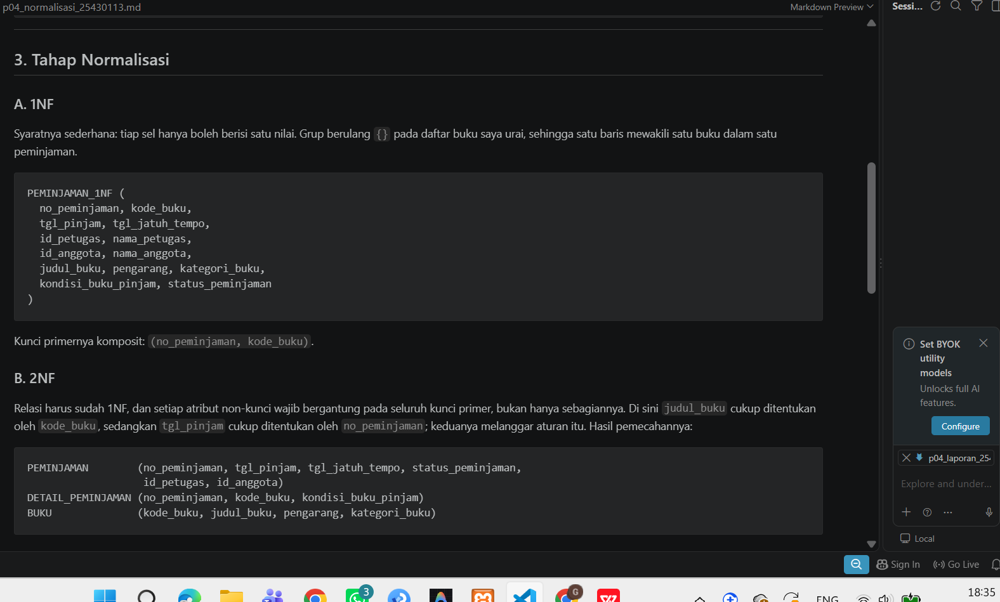
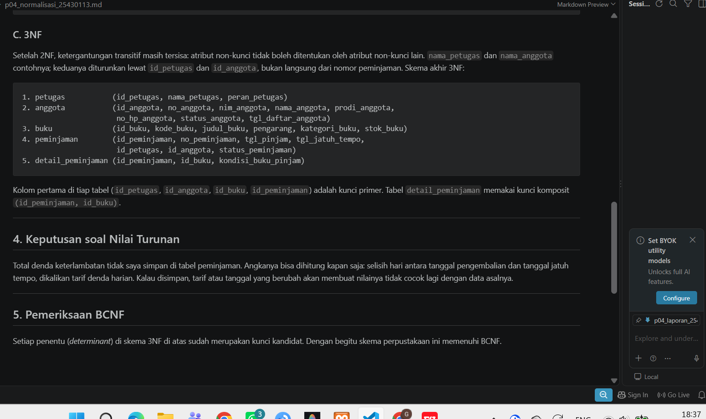

# Laporan Praktikum Basis Data - Pertemuan 04

**Nama:** Gustyan Tama Tiyadie
**NIM:** 25430113
**Kelas:** D
**Tanggal:** 2026-10-20

---

## 1. Tujuan Praktikum

1. Mengenali anomali ubah, sisip, dan hapus pada data yang belum dinormalisasi.
2. Menulis dependensi fungsional berdasarkan aturan bisnis.
3. Menormalisasi relasi sampai 3NF, lalu memeriksa apakah BCNF terpenuhi.
4. Memutuskan nilai turunan mana yang disimpan, dan mendokumentasikan skema relasional akhir proyek perpustakaan.

---

## 2. Ringkasan Dasar Teori

Normalisasi adalah cara menata data supaya tidak berulang tanpa perlu, bebas dari anomali ubah, sisip, dan hapus, serta tetap konsisten. Prosesnya berjalan bertahap:

* **UNF (Unnormalized Form):** data mentah yang masih menyimpan grup berulang (`{}`).
* **1NF (First Normal Form):** grup berulang dihapus sehingga tiap atribut atomik, dan kunci primer komposit ditetapkan bila perlu.
* **2NF (Second Normal Form):** relasi sudah 1NF, dan setiap atribut non-kunci bergantung pada seluruh kunci primer, tidak hanya sebagian.
* **3NF (Third Normal Form):** relasi sudah 2NF, dan tidak ada atribut non-kunci yang bergantung pada atribut non-kunci lain (ketergantungan transitif).
* **BCNF (Boyce-Codd Normal Form):** setiap penentu (*determinant*) merupakan kunci kandidat.

---

## 3. Hasil Langkah Percobaan (Studi Kasus Kopma D.1 sampai D.4)

### D.1 Dari UNF ke 1NF

Relasi awalnya berupa nota penjualan yang menyimpan data barang dalam satu grup berulang:


**Bentuk 1NF**

```text
NOTA_1NF (
  no_nota_penjualan, kode_barang,
  tgl_penjualan, kode_petugas, nama_petugas,
  no_anggota, nama_anggota, nama_barang,
  qty_detail_penjualan, harga_satuan_detail_penjualan, subtotal_detail_penjualan,
  jumlah_penjualan, diskon_penjualan, total_penjualan
)
```

Kunci primernya komposit: `(no_nota_penjualan, kode_barang)`.

### D.2 Dependensi Fungsional (FD)

```text
no_nota_penjualan -> tgl_penjualan, kode_petugas, no_anggota
kode_petugas -> nama_petugas
no_anggota -> nama_anggota
kode_barang -> nama_barang
(no_nota_penjualan, kode_barang) -> qty_detail_penjualan, harga_satuan_detail_penjualan
```

### D.3 Menuju 2NF dan 3NF

* **2NF:** atribut yang hanya bergantung pada sebagian kunci saya pindahkan ke tabel tersendiri, menghasilkan `penjualan`, `barang`, dan `detail_penjualan`.
* **3NF:** ketergantungan transitif saya pisahkan juga. Skema kanonik akhir Kopma jadinya 8 tabel: `petugas`, `anggota`, `barang`, `pemasok`, `penjualan`, `detail_penjualan`, `pembelian`, dan `detail_pembelian`.

### D.4 Pencocokan Skema Kanonik dan Pemeriksaan BCNF

Semua relasi di skema kanonik sudah saya periksa: tidak ada anomali yang tersisa, dan syarat BCNF terpenuhi.



---

## 4. Jawaban Titik Analisis

* **Titik Analisis 1:** Harga satuan disimpan di detail penjualan, pada baris yang dikunci komposit. Dengan begitu transaksi lama tetap menunjukkan harga saat barang dibeli, meski harga katalog naik belakangan.
* **Titik Analisis 2:** Total tidak disimpan di tabel operasional. Angkanya bisa dihitung dari kuantitas dan harga satuan, dan menyimpannya hanya membuka peluang selisih antara total dan data asalnya.
* **Titik Analisis 3:** Pemasok terhubung lewat riwayat pembelian, bukan lewat katalog barang. Koperasi bisa ganti pemasok kapan saja tanpa merusak data dasar barang.

---

## 5. Hasil Latihan dan Modifikasi
* **Poin 1 (Nomor Telepon Pemasok):** Analisis dan pemecahan relasi untuk atribut bernilai banyak (*multivalued attribute*) pada nomor telepon pemasok agar memenuhi bentuk normal pertama hingga ketiga telah didokumentasikan secara rinci pada berkas normalisasi Kopma terpisah.

* **Poin 2 (Pelanggaran 3NF & Anomali Ubah):** Pengujian sampel data yang melanggar ketergantungan transitif pada atribut `nama_anggota` di tabel penjualan beserta simulasi kueri *update anomaly* telah dianalisis lengkap pada berkas terpisah.


---

## 6. Tugas Mandiri: Milestone Proyek 4 (Tema Perpustakaan)

Berdasarkan dokumen kebutuhan data proyek **Perpustakaan Cakrawala GT** , normalisasi dari slip peminjaman sampai 3NF  berjalan seperti ini:

1. **Titik awal UNF:** slip peminjaman memuat data peminjam, petugas, dan daftar buku yang berulang (`{}`).
2. **Dependensi fungsional:** diturunkan dari aturan bisnis peminjaman buku.

3. **1NF:** grup berulang dihapus, dan kunci primer komposit ditetapkan: `(no_peminjaman, kode_buku)`.
4. **2NF:** atribut non-kunci yang bergantung sebagian dipisah menjadi `peminjaman`, `detail_peminjaman`, dan `buku`.

5. **3NF:** ketergantungan transitif dipisah, dan entitas akhirnya adalah `petugas`, `anggota`, `buku`, `peminjaman`, serta `detail_peminjaman`.
6. **Nilai turunan:** total denda keterlambatan dihitung dari selisih hari pengembalian, tanpa disimpan di tabel operasional.


---

## 7. Pembahasan dan Kendala

* **Kendala:** saya sempat salah menunjuk atribut mana yang bergantung sebagian ketika beralih dari 1NF ke 2NF.
* **Solusi:** saya cek ulang aturan bisnis dan dependensi fungsionalnya satu per satu, dengan relasi antarentitas proyek perpustakaan sebagai acuan.

---

## 8. Kesimpulan

1. Normalisasi menghilangkan anomali data dan menjaga informasi tetap konsisten.
2. Skema relasional 3NF untuk proyek Perpustakaan sudah selesai dirancang dan siap ditulis sebagai skrip DDL di Modul 5.

---

## 9. Pernyataan Penggunaan AI

* **Alat yang dipakai:** Gemini AI dan Claude AI
* **Untuk apa:** memahami cara memecah UNF ke 1NF, dan menyusun kerangka draf laporan normalisasi 3NF untuk tema Perpustakaan.
* **Bagian yang terbantu:** struktur penulisan laporan dalam Markdown dan perumusan tahap dependensi fungsional.

---

## 10. Bukti Git

* **Tautan repositori:** `https://github.com/gustyantamatiyadie837-tech/basisdata-25430113.git`
* **Hash commit:** `17e481f`

---

## Checklist

- [x] Identitas lengkap sesuai ketentuan
- [x] Tujuan dan ringkasan teori ditulis dengan bahasa sendiri
- [x] Hasil langkah percobaan D.1 sampai D.4 tercatat lengkap
- [x] Seluruh Titik Analisis dijawab beserta alasannya
- [x] Latihan dan Modifikasi (2 poin) disertakan
- [x] Tugas Mandiri (Milestone Proyek 4 Tema Perpustakaan) lengkap dari UNF sampai 3NF
- [x] Pembahasan kendala dan kesimpulan ada
- [x] Pernyataan penggunaan AI diisi dengan jujur
- [x] Bukti Git dan tautan commit disertakan
